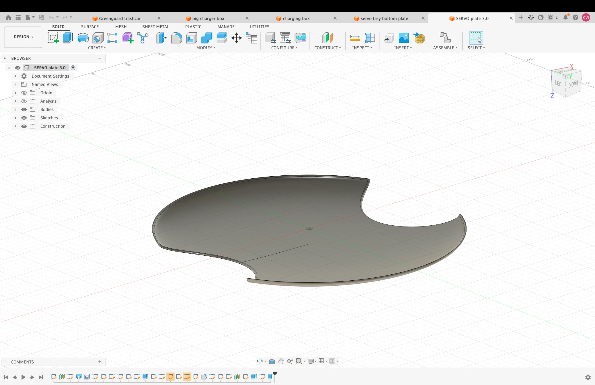
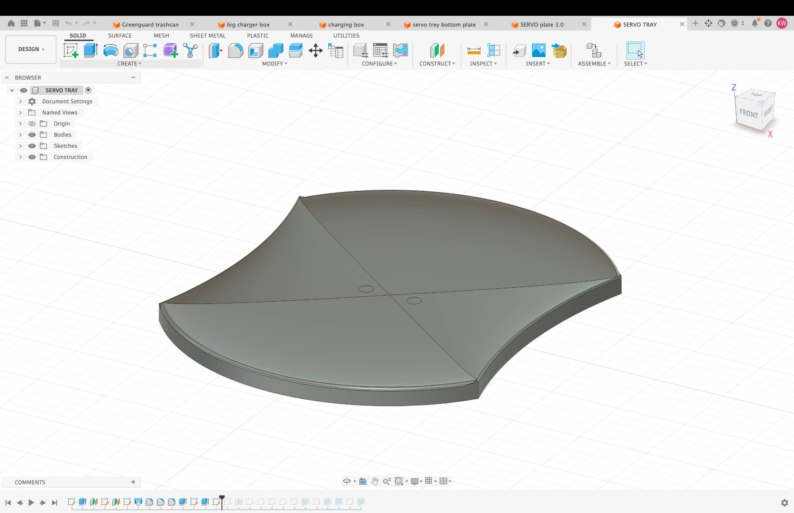
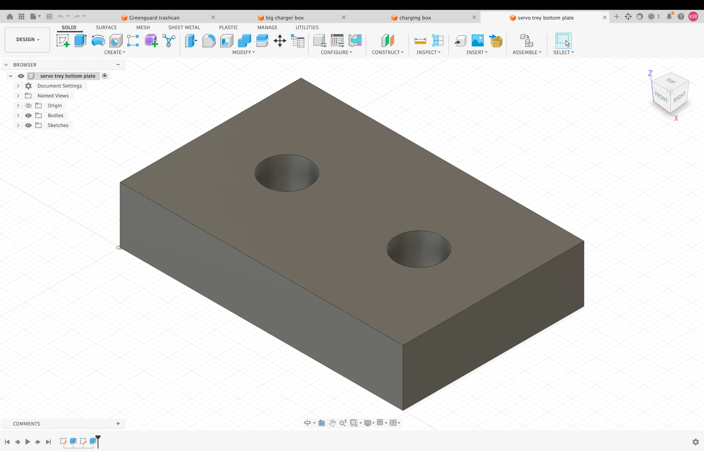
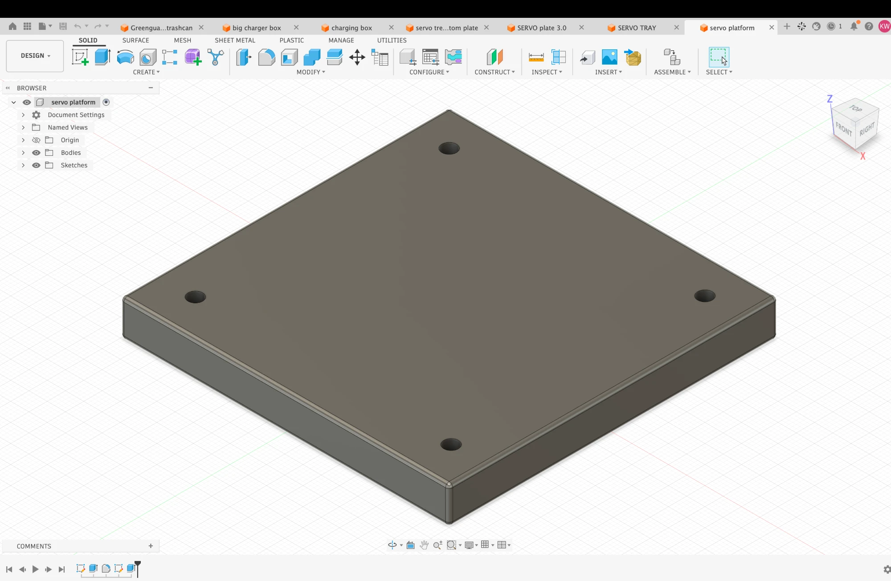
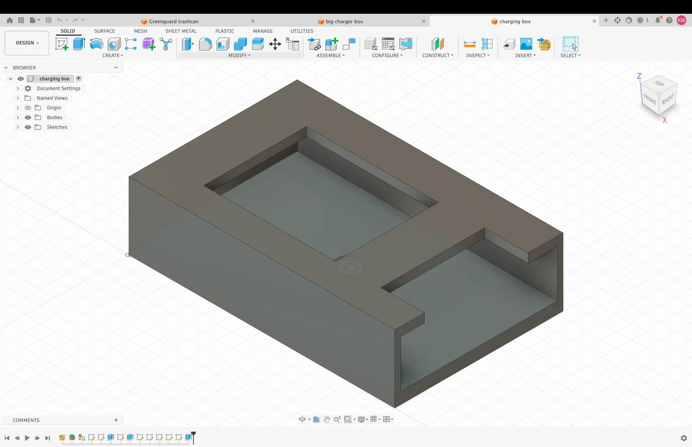
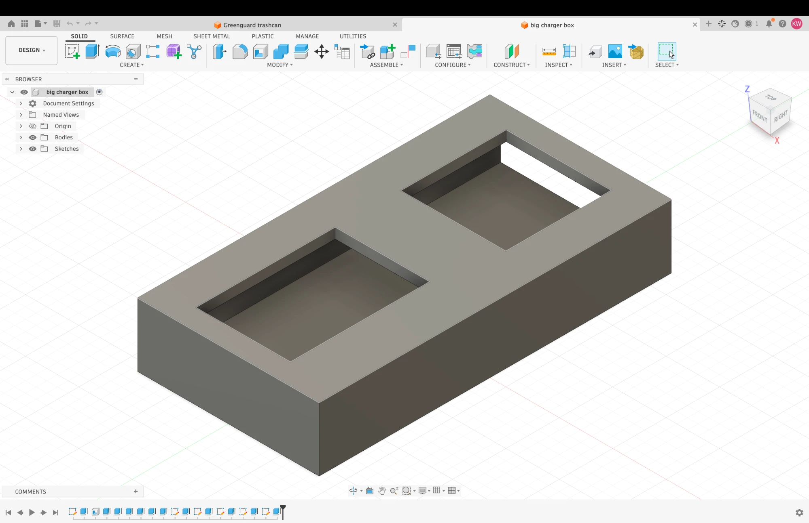
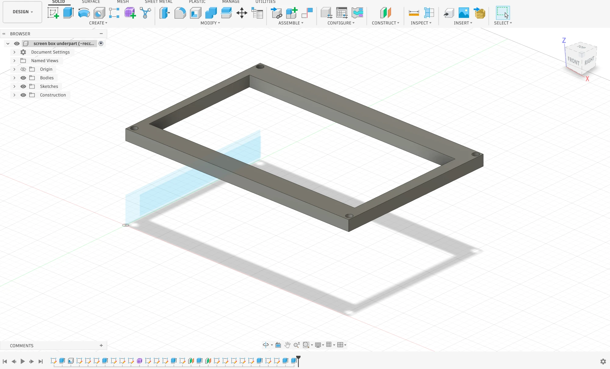

# Engineering Journal: AI Smart Recycling Bin

**Author:** Kevin Wei
**Repository:** https://github.com/kevinwei0117/raspi-ai-trashcan (private)

> Written up in November 2026 from my own memory and my Fusion 360 files. **Dates are estimates**
> (I remember building the frame about a week before the conference on Sept 22). No file has exact dates.

---

## Day 0: Building the physical bin (estimated September 14–16, 2026, about a week before the conference)
### Frame, divider, and my first 3D-printed parts

### Short version (for the journal)
> **What I worked on:** Built the physical bin. I bought a used **8-gallon trash can for $30**, **took apart an old Ender 3 3D printer** to reuse its aluminum frame, assembled it on the can, and added a divider to separate recycling from trash. Then I designed and 3D-printed parts in **Fusion 360**: battery holders, the servo platform, and the tray plate.
>
> **Problems:** The battery holder came out too small. The servo tray plate failed twice: the first version was too thin, and the second **snapped**.
>
> **Fix:** Measured the real parts, redesigned in Fusion 360, and reprinted until everything fit and held up.
>
> **What I learned:** The first design almost never works. Measuring real parts and testing quickly is how you get it right. Thin PLA parts snap under the stress of a moving servo.
>
> **Cost:** about **$200** for the whole build.

---

### Day 0a (est. Mon, Sep 14): Frame and divider
- **Trash can:** used **8-gallon** can, bought from someone for **$30**.
- **Frame:** I **disassembled an old Ender 3 3D printer** and reused its **aluminum extrusion frame** to build a structure over and around the can (to hold the camera, screen and electronics above the tray).
  - **Why:** reusing parts saved money and gave me a strong, adjustable metal frame. Reusing old hardware also fits a recycling project.
- **Divider:** a wall down the middle of the can, splitting it into a **Recycle** side and a **Trash** side. **My dad helped me make the divider.**

### Day 0b (est. Tue, Sep 15): First 3D-printed parts + screen
- Started designing 3D-printed parts in **Fusion 360** to mount onto the trash can and frame.
- First part: **holders for the battery packs** that power the servos.
- Got the **screen working**, so it shows the live camera view (and later the AI's answer).

### Day 0c (est. Wed, Sep 16): Print, fail, redesign, reprint
All parts printed in **PLA** (the only filament I had).

| Part | Version 1 | Version 2 | Final |
|---|---|---|---|
| Battery holder | `charging box`: **too small**, batteries didn't fit | `big charger box`: resized to the measured battery packs | ✅ fits |
| Servo tray plate (holds the item, tilts to drop it) | **Too thin**: flexed under the servo | `SERVO TRAY`: **snapped** | ✅ `SERVO plate 3.0` |
| Servo platform (mounts the servo on top of the can) | `servo platform` | | ✅ works |

**How the final tray attaches to the servo:**
- `servo trey bottom plate` is a **thick block** under the tray with **2 large holes**.
- I put **threaded inserts** into those holes and **screwed the plate onto the servo**, so the tray stays firmly attached instead of relying on thin plastic.
- That spreads the force from the servo through a solid block, instead of concentrating it where the thin plate snapped.

### My Fusion 360 designs (all 8 parts for the bin)

| Fusion file | What it does on the bin |
|---|---|
| `Greenguard trashcan` | Main project file. **GreenGuard** is the project's name. |
| `charging box` | Battery/charger holder, version 1 (too small) |
| `big charger box` | Battery/charger holder, version 2 (final) |
| `servo platform` | Square plate with 4 corner screw holes that mounts the servo on top of the trash can |
| `servo trey bottom plate` | Thick block with threaded inserts that screws onto the servo and holds the tray |
| `SERVO TRAY` | Tray, earlier version (snapped) |
| `SERVO plate 3.0` | **Final tray:** round with a raised lip. The **curved cut-outs** are on the sides it tips toward, so when the plate tilts, the item **slides out more easily** instead of catching on the lip. |
| `screen box underpart` | Frame with 4 screw holes that holds the screen |

**Screenshots (from Fusion 360):**

| | |
|---|---|
|  **Final tray: `SERVO plate 3.0`** |  **Earlier tray: `SERVO TRAY`** |
|  **`servo trey bottom plate`** (holes for threaded inserts) |  **`servo platform`** |
|  **`charging box`** (v1, too small) |  **`big charger box`** (v2) |
|  **`screen box underpart`** | |

**Why the plate failed:**
- The tray plate is attached to a servo that moves fast and stops suddenly. That puts a lot of **stress on the plate**, especially around where it attaches.
- **PLA is stiff but brittle**: it snaps instead of bending.
- A thin plate both **flexes** (version 1) and **concentrates stress** until it cracks (version 2).

### What I learned
1. **Measure the real parts before designing.** The battery holder failed because of the size, not the idea.
2. **Iterate fast:** design → print → test → fix. Each failure told me exactly what to change.
3. **Material matters:** PLA is easy to print but brittle under repeated motion. For moving parts, thicker walls, more infill, or a tougher plastic (like PETG) would hold up better. *(This is one reason my v2 design uses PETG.)*
4. **Asking for help is part of building:** my dad helped with the divider.

### Cost (approximate)

| Item | Cost |
|---|---|
| Used 8-gallon trash can | $30 |
| Everything else (servos, PCA9685, wiring, batteries, PLA, screen, etc.) | ~$170 |
| **Total** | **~$200** |

*(The Raspberry Pi, camera, and the Ender 3 used for the frame were things I already had, or details to confirm.)*

### Evidence to add
- [x] Fusion 360 design screenshots (added above)
- [ ] Slicer / print file dates
- [ ] Phone photos of the build, the snapped plate, and the frame going up
- [ ] Photo of the finished bin (I have one from Nov 14: the frame, screen, tray, battery box, and "TRASH" / "RECYCLING ONLY" signs)
