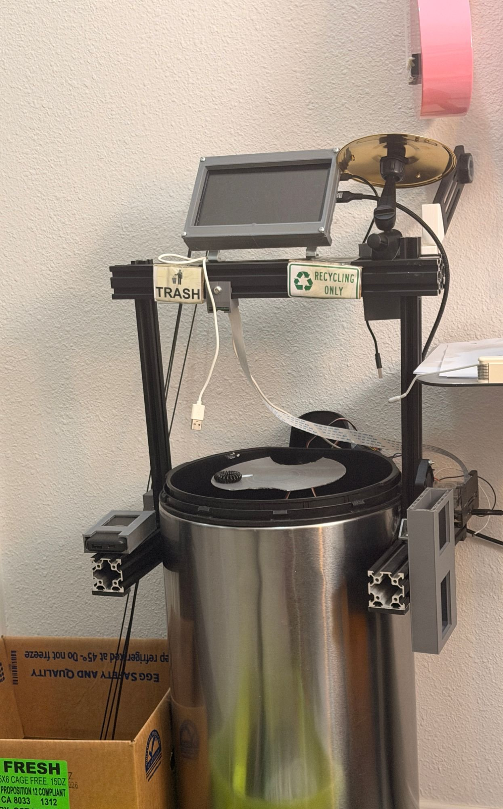
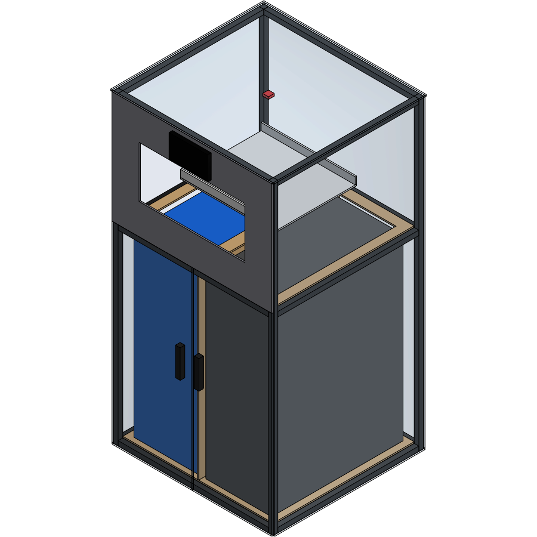
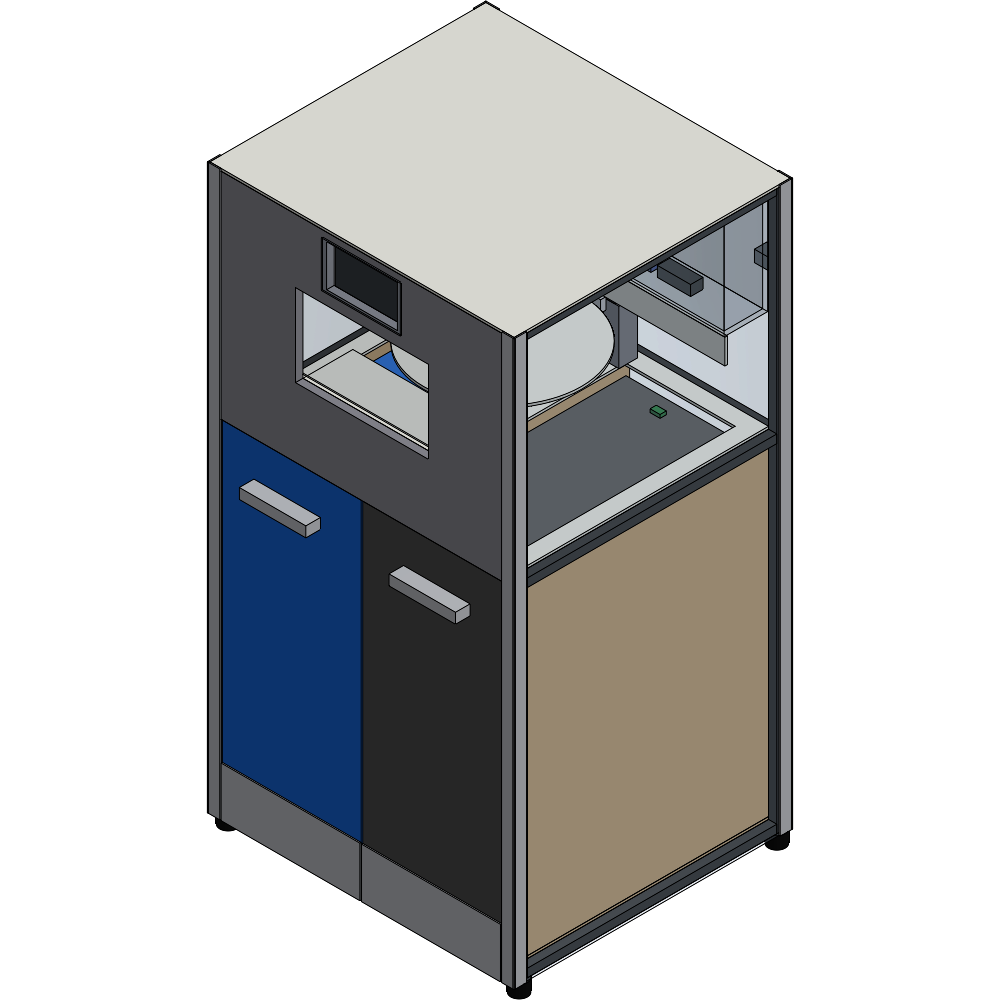
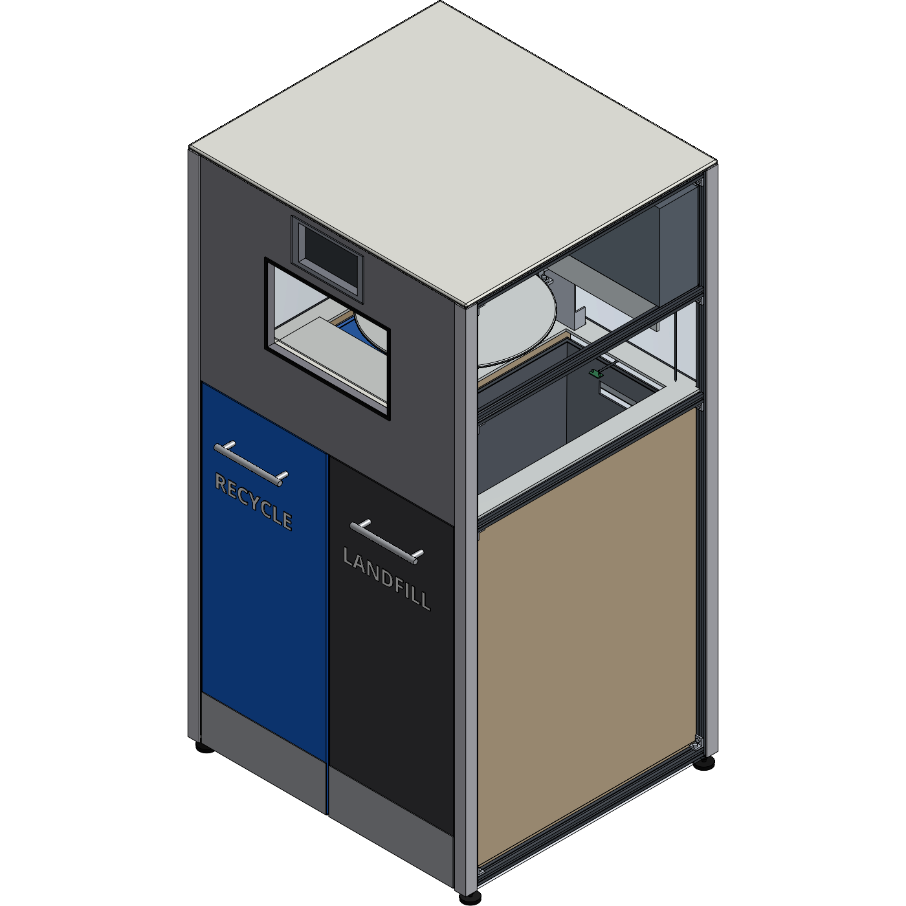
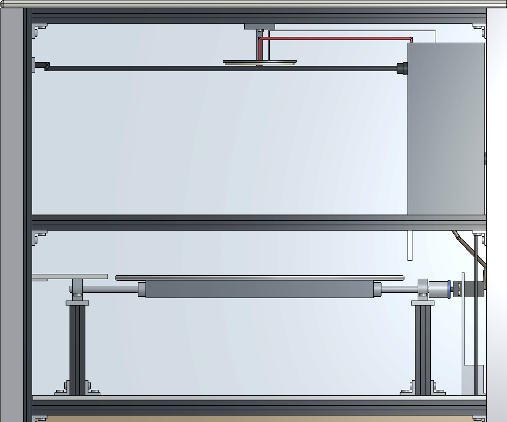
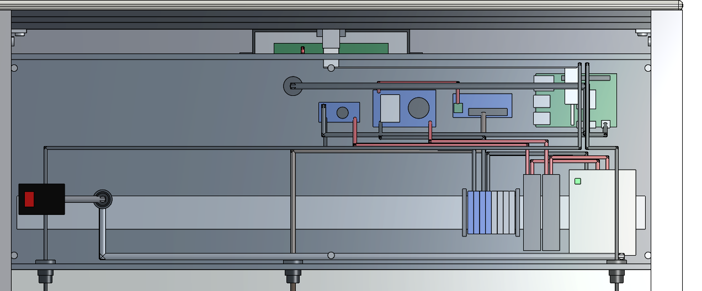

# Engineering Journal: AI Smart Recycling Bin (GreenGuard)

**Author:** Kevin Wei

> Written up from my chat logs and the Onshape document history of Nov 14, 2026.

---

## Day 8: Saturday, November 14, 2026
### GreenGuard version 2 design in Onshape

### Short version (for the journal)
> **What I did:** Took a photo of version 1 and listed what had to change for real public use: much bigger bins, bags that are easy to remove, electronics protected from dirt, and a design tough enough that people can't break it. Version 2 was then laid out in Onshape and went through three revisions in one day.
>
> **Key decisions:** Two pull-out drawers instead of one can with a divider. One servo that tilts left or right instead of two servos. A round tray like commercial AI bins. A sealed electronics bay.
>
> **What I learned:** Designing for the public is different from building a prototype. Durability, easy cleaning and safety matter as much as the AI.
>
> **Next:** Make it affordable enough to build 5–6.

### Version 1: what had to change

| Problem with v1 | Requirement for v2 |
|---|---|
| 8-gallon can fills fast | Much bigger bins |
| The bag is very hard to take out | Bins that **slide out the front** |
| Electronics exposed to dirt | A **sealed electronics area** |
| Not built for the public | **Durable**, so people can't wreck it |
| Two servos (rotate + tilt) | Simpler mechanism |

### Revisions

**Rev A: first layout.** A cabinet with two bins, a deck with drop openings, a tray, a camera and a screen.

**Rev B: my requested changes.**
- **Pull-out drawers** on 22-inch slides, so bins come straight out the front.
- **Round tray** (like the Ameru AI bin), tilting **left = Recycle, right = Trash**: one servo instead of two.
- **Sealed electronics bay** at the top back, away from falling trash.
- **Durability:** aluminum corner guards, kick plates, a polycarbonate screen guard, and a flap over the opening so hands can't reach the tray.

**Rev C: realistic hardware ("make it realistic, with the hardware connected").**
276 parts: real 2020 T-slot frame with brackets and screws, DS3235 servo on a bracket, KP08 bearings and an 8 mm shaft, a wired electronics bay (DIN rail, 12 V supply, fuses, Pi 4, PCA9685), cable glands, the camera on a ceiling beam with an LED ring, and tapered bins with bags.

**Problem with rev C:** estimated cost **~$1,200–1,500 per bin.** Too expensive to build 5–6. (Day 9)

### Evidence
- Onshape document "Smart Recycling Bin v2" (version history)
- My chat log from Nov 14, 2026
- Renders above
