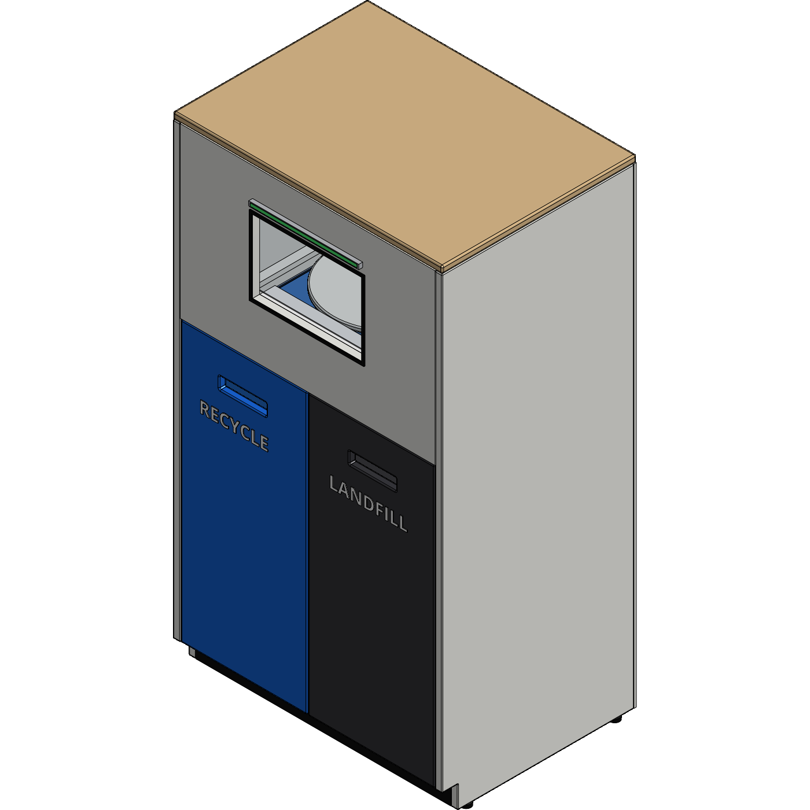
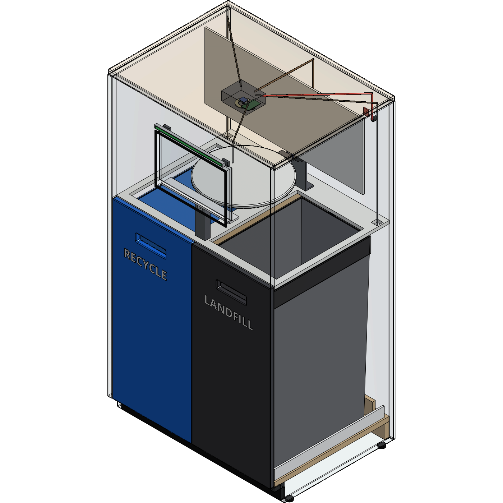

# Engineering Journal: AI Smart Recycling Bin (GreenGuard)

**Author:** Kevin Wei

> Written up from my chat logs, the Onshape document history, and the Git history of Nov 14, 2026.

---

## Day 9: Saturday, November 14, 2026 (afternoon/evening)
### Cutting the cost from ~$1,400 to ~$230 per bin, and backing up the code

### Short version (for the journal)
> **What I did:** Version 2 was too expensive to build 5–6 of, so it was redesigned to be cheap without looking cheap. Then I went home and backed up all my code to GitHub for the first time.
>
> **Key decisions:** A painted plywood cabinet instead of an aluminum frame. A cheap ESP32 camera board in each bin, with **my Raspberry Pi as one shared AI server** for all of them. Plastic runners instead of metal slides. A 12-inch cutting board as the tray.
>
> **Result:** about **$230 per bin, ~$1,400 for 6**, compared with ~$8,000 before.
>
> **What I learned:** The biggest savings come from changing the architecture (one shared AI server), not from finding cheaper parts.

### Cost redesign (rev D)

| Before (rev C) | Cost | After (rev D) | Cost |
|---|---|---|---|
| Aluminum extrusion frame + brackets | ~$212 | Painted plywood cabinet, rounded edges | ~$85 |
| ACM / HDPE / polycarbonate panels | ~$515 | Plywood + hardboard back | (included) |
| Pi 4 + PSU + DIN rail + screen in **every** bin | ~$250 | **ESP32-S3 camera board** per bin + **one shared Pi 4 server**; LED status bar instead of a screen | ~$45 |
| Ball-bearing slides | ~$80 | UHMW plastic runners | ~$8 |
| 23-gallon bins | ~$100 | 13-gallon kitchen-bag bins | ~$30 |
| Bearings, plates, 35 kg servo | ~$73 | 608 skateboard bearings in printed blocks, DS3218 servo | ~$23 |

- **Size:** about 68 × 49 × 123 cm, 26 gallons total (3× version 1).
- **Trade-off I noted:** the ESP32 camera is different from the Pi camera, so the AI will probably need retraining with new photos.

### Backing up the code (evening)
- Found that my code was connected to my **mentor's** GitHub repository, and that **my changes had never been uploaded**.
- Kept the mentor's repository untouched and created my own private one: `kevinwei0117/raspi-ai-trashcan`.
- First commit of my work: **`7c74974`**, Nov 14, 5:40 PM PST: *"My changes: servo fixes, tilt/rotate tuning, shutdown button, UN demo version"*. 13 files, +334 / −120 lines, including the AI model (2.7 MB), which hadn't been backed up before.
- Fixed a duplicate file (`src/category_map.` was identical to `category_map.py`, confirmed with `cmp`).

### Evidence
- Git commit `7c74974` (Nov 14, 17:40 PST)
- Pi boot record: Nov 14, 18:58 PST (`journalctl --list-boots`)
- Onshape document history (rev D)
